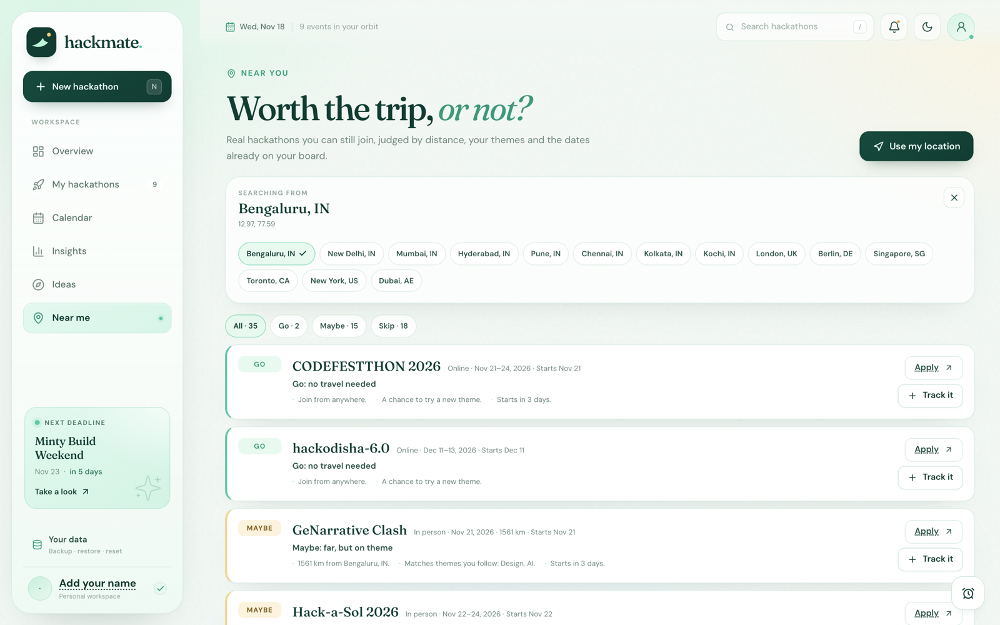
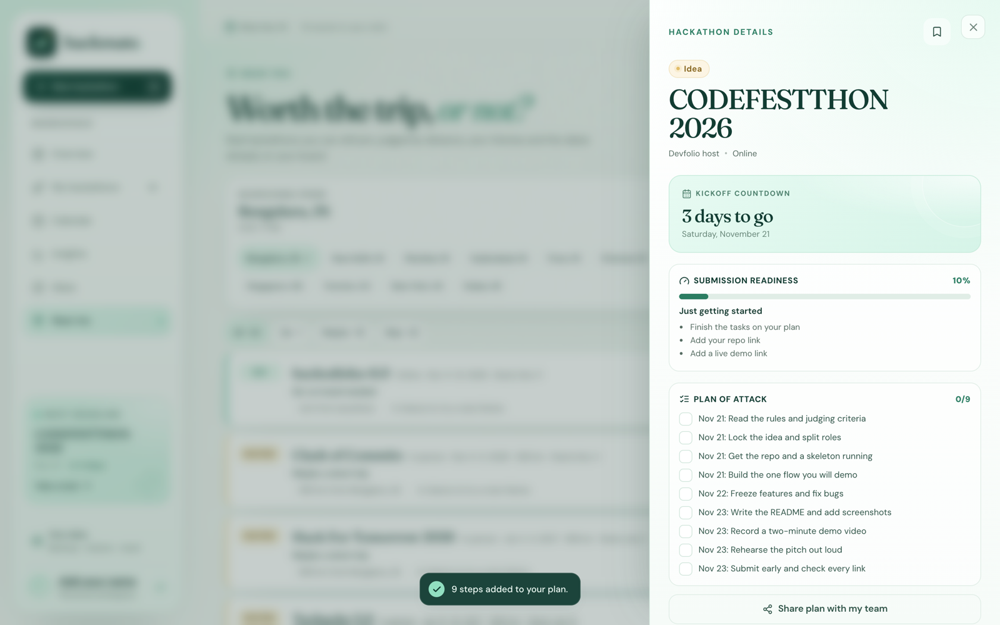
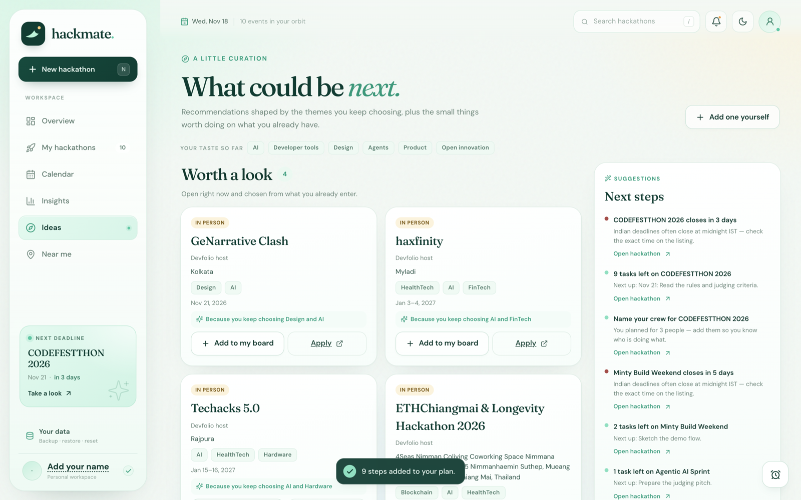
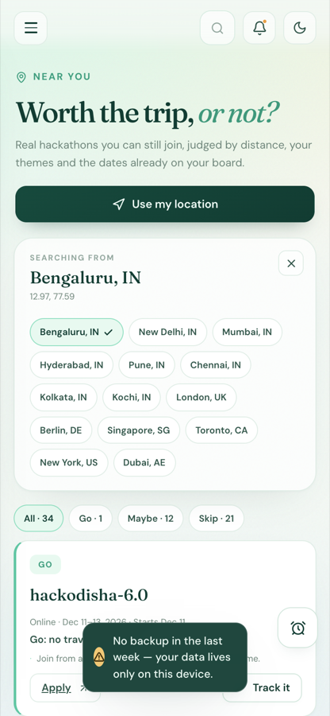
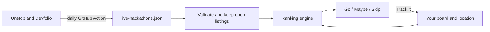

# hackmate.

**Find the hackathon worth your weekend, then actually ship for it.**

Students miss hackathons because listings are scattered, deadlines slip, and nobody knows if a trip is worth it. Hackmate pulls open hackathons into one place, tells you **Go, Maybe or Skip** with a reason, and turns your pick into a day-by-day plan.



## What makes it different

- **Go / Maybe / Skip on real listings.** Each open hackathon from Unstop and Devfolio is judged on distance, how well it matches your themes, and clashes with your calendar. Every verdict shows its reasons.
- **Sprint planner.** One tap spreads a proven hackathon routine across the days you really have.
- **Submission readiness score.** A live percentage and the three things that would raise it most.
- **Portfolio export.** Turns what you shipped into a Markdown page for GitHub or a resume.
- **Private by design.** No account and no server. Your data stays on your device.
- **Works everywhere.** Installable web app, offline support, and an Android app with system reminders.

| Plan the sprint | Find what fits | On your phone |
| --- | --- | --- |
|  |  |  |

## Also inside

Overview with countdowns, a searchable board, calendar with `.ics` export, insights, focus timer, deadline reminders, JSON backup and restore, dark mode, and keyboard shortcuts (`N` new, `/` search, `Esc` close).

## How it works



The logic lives in small, tested modules in `src/lib`:

| Module | Job |
| --- | --- |
| `live.ts` | Validates feed data and selects open listings |
| `finder.ts` | Locates venues, measures distance, ranks listings |
| `planner.ts` | Builds the sprint plan |
| `readiness.ts` | Scores submission readiness |
| `portfolio.ts` | Writes the Markdown portfolio |
| `reminders.ts` | Schedules deadline reminders |
| `platform.ts` | Handles file export on web and Android |

**Stack:** React 19, TypeScript, Vite, Capacitor, Vitest, GitHub Actions, hand-written CSS.

## Run it

```bash
npm install
npm run dev
```

| Command | What it does |
| --- | --- |
| `npm test` | Runs the unit tests |
| `npm run build` | Type-checks and builds to `dist/` |
| `npm run preview` | Serves the production build |
| `npm run fetch:hackathons` | Refreshes the listings |

Build the Android app with JDK 21 and the Android SDK:

```bash
npm run build
npx cap sync android
cd android && ./gradlew assembleDebug
```

## Honest limits

- Listings come from public, unofficial endpoints, so a source can change or go down. The app then keeps the last saved list.
- Devfolio publishes no sign-up cutoff, so Hackmate shows its start date and says so.
- Distances are straight-line estimates, and venues outside the known city list get a Maybe.

See [the demo script](docs/DEMO.md) for a two-minute walkthrough.
